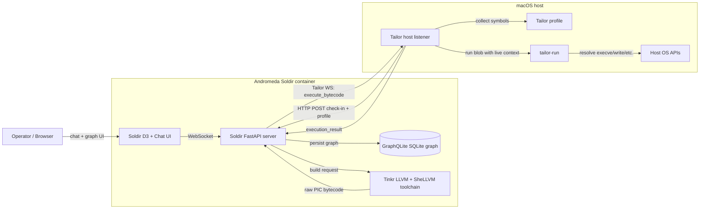

# Andromeda

Andromeda combines three local components into one workflow for generating, transporting, visualizing, and executing Tinkr bytecode through a live Tailor runtime context.

## Components

| Component | Directory | Function |
| --- | --- | --- |
| Tinkr | `tinkr/` | LLVM + SheLLVM toolchain and agent code that turns prompts or deterministic fixtures into raw PIC bytecode blobs. |
| Tailor | `tailor/` | Host-side runtime profiler and blob runner. It keeps the original `tailor` C namespace and headers, checks in with Soldir, listens on a WebSocket, and executes delivered bytecode with a live resolver context. |
| Soldir | `soldir/` | Web app, graph database, WebSocket broker, Tinkr orchestration service, and agentic chat surface. It receives Tailor check-ins and dispatches generated bytecode jobs. |

## Start

Start the Soldir container and the host-side Tailor listener:

```sh
./start.sh
```

Start with Soldir UX/test graph mode enabled:

```sh
./start.sh --test-mode
```

Useful variants:

```sh
./start.sh --no-listener   # only start the Soldir container
./start.sh --no-build      # reuse the existing container image
./stop.sh                  # stop the listener and container
```

Soldir is served at `http://127.0.0.1:8765`. Listener logs go to `logs/tailor-listener.log`.

## LLM Provider Environment

`./start.sh` passes the current shell's LLM provider environment into the Soldir container. Export keys before startup, or place them in Compose's `.env` file at the Andromeda root:

```sh
export OPENAI_API_KEY=...
export ANTHROPIC_API_KEY=...
export XAI_API_KEY=...
export OLLAMA_BASE_URL=http://host.docker.internal:11434
./start.sh
```

Supported pass-through variables: `XAI_API_KEY`, `XAI_BASE_URL`, `XAI_MODEL`, `OPENAI_API_KEY`, `OPENAI_BASE_URL`, `OPENAI_MODEL`, `ANTHROPIC_API_KEY`, `ANTHROPIC_BASE_URL`, `ANTHROPIC_MODEL`, `OLLAMA_BASE_URL`, and `OLLAMA_MODEL`. Startup reports only which providers are configured, never the secret values.

## Demo

See [DEMO.md](DEMO.md) for the full blank-graph -> Tailor check-in -> Tinkr payload -> host execution workflow.

## Smoke Job

After `./start.sh`, trigger the macOS `say` smoke job:

```sh
curl -fsS -X POST http://127.0.0.1:8765/api/jobs/macos-say-smoke \
  -H 'content-type: application/json' \
  -d '{"target_triple":"arm64-apple-macos","message":"smoke test of pwnage"}'
```

Soldir generates an `arm64-apple-macos` Tinkr blob, sends it over the Tailor WebSocket, and Tailor executes it on the host through `tailor/bin/tailor-run`.

## Architecture



## Notes

- The Soldir container can build macOS bytecode, but macOS blobs must execute on the host-side Tailor listener.
- Use only on systems and processes you own or are explicitly authorized to test.
